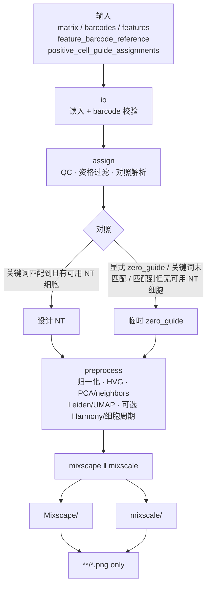

# 分析规则

写出哪些文件、图何时跳过，见 [outputs.md](outputs.md)。

## 目录

1. [流水线步骤](#流水线步骤)
2. [命令行与配置](#命令行与配置)
3. [物种](#物种)
4. [CRISPR 模式](#crispr-模式)
5. [对照](#对照)
6. [QC](#qc)
7. [分配](#分配)
8. [Barcode](#barcode)
9. [Mixscape 与 Mixscale](#mixscape-与-mixscale)
10. [相对对照的标准化](#相对对照的标准化)
11. [预处理与簇注释](#预处理与簇注释)

---

## 流水线步骤

固定顺序：

```text
io → assign → preprocess → mixscape ‖ mixscale
```

每次运行均跑 **Mixscape 与 Mixscale**（进程池并发；各进程读临时 preprocess 副本；不写 `checkpoints/`）。两者都跑完且已有 Mixscape 标签时，会重画 `mixscale/` 图以便按 NT|NP|KO 分面。不支持 `--resume`、不落盘 h5ad；须从 `io` 起连续跑。

### 数据分析流程图



| 步骤 | 作用 | 输出目录 |
| --- | --- | --- |
| `io` | 读入矩阵 / 参考 / 分配（账本在内存） | — |
| `assign` | QC、资格过滤、对照解析；AnnData 子集为 **QC-pass**（供嵌入）；`analysis_eligible` 写入 obs；写出过滤前 / 描述性 `qc/` 图 | `qc/` |
| `preprocess` | 归一化、HVG、PCA（30）、UMAP / Leiden / SingleR / ScType（均在 QC-pass 上）；HVG/PCA/marker 与 UMAP 均写 `UMAP/` | `UMAP/` |
| `mixscape` | 在 `analysis_eligible` ∪ 对照上：DE 门 → 签名 → 分类 | **`Mixscape/`**、`UMAP/` |
| `mixscale` | 同范围独立 DE 门 → `mixscale_score` | **`mixscale/`** |

图在**对应分析步骤结束时**写出。跑完做 lean cleanup：默认只留 `**/*.png`；同目录输入输出时另保护 `{sample}.scRNA.*` 与已解析 DRAGEN 输入（细节见 [outputs.md](outputs.md)）。本流水线不含独立 Wilcoxon DGE / E-distance / perturb 步骤。

### 并行与限制

| 项 | 行为 |
| --- | --- |
| Mixscape / Mixscale | 进程池并发 |
| 共享输入 | 各 worker 读**临时** preprocess.h5ad（非输出目录） |
| 输出隔离 | `mixscape`→`Mixscape/`；`mixscale`→`mixscale/` |
| 线程 | 默认 `runtime.n_threads = max(1, CPU//3)` |

`preprocess.n_pcs` 与 `mixscape.n_dims` 须同为 30。

---

## 命令行与配置

`config/config.yaml` 只放软件默认参数。样本名、物种、目录、guide 分隔符、非靶向对照、CRISPR 模式和 ScType 由命令行传入。不传 `--config` 时读默认文件；命令行覆盖同名字段。ScType **不在** YAML 中配置。

出现代码不读取的配置键会失败（`未识别的配置键` + 路径）。`labels.flag_guides_above` 无效；靶基因数门槛键为 `labels.targets_per_cell`。

| 参数 | 说明 |
| --- | --- |
| `--organism` | 必填 `human` / `mouse` → `experiment.organism` |
| `--crispr-mode` | `KO` / `i` / `a`，默认 `KO`；写入预期方向与图标签（KO→`not_required`，i→`down`，a→`up`；图注 KO/KD/OE） |
| `--validate-only` | 只检查参考表和 barcode |
| `--batch-key` / `--cell-type-key` | 空则不做 Harmony；`cell_type` 保持 `ALL` |
| `--min-genes` / `--max-genes` | 覆盖默认 200 / 6000 |
| `--max-mito-frac` | 覆盖默认 `0.2` |
| `--nt-control` | 默认 `NEG_CONTROL/Non-Targeting/NegCtrl`（忽略大小写精确匹配参考表四列；`/` 或 `,` 可自定义）；默认或自定义均未匹配 → 自动 `zero_guide`；可显式填 `zero_guide`；匹配到但无可用 NT 细胞 → 回退临时 `zero_guide` |
| `--sctype-tissue` | 启用 ScType；argparse choices 来自离线 DB（如 `Adrenal`、`Immune system`、`Lung`…）；未传则跳过 |
| `--sctype-db-path` | 可选 marker DB 路径（tsv/csv/xlsx）；默认 `data/sctype/ScTypeDB_full.tsv` |
| `--sctype-low-score-fraction` | 可选；簇顶分 `< n_cells * fraction` → `Unknown`（默认 0.25） |
| `--config` | 软件默认 YAML；缺省 `config/config.yaml` |

常用 YAML 键（完整默认见 `config/config.yaml`）：

| 键 | 作用 |
| --- | --- |
| `qc.min_genes` / `max_genes` / `max_mito_frac` | QC 过滤（CLI 可覆盖） |
| `qc.min_cells_per_target` | 靶向细胞数 **<** 该值 → `low_cells_target`（默认 20）；决定 `analysis_eligible` |
| `qc.min_cells_per_guide` | 仅用于 `cells_per_target` 表的 `n_guides_passing` 统计（默认 10）；**不**直接排除细胞 |
| `preprocess.n_hvg` / `n_pcs` / `leiden_resolution` | HVG / PCA / Leiden（`n_pcs` 默认 30，与 `mixscape.n_dims` 一致） |
| `mixscape.*` / `mixscale.*` | 各自 DE 门与算法参数（`logfc_threshold` 默认 0.1 等） |
| `singler.enabled` | `false` 跳过 SingleR 与组合注释图 |
| `runtime.n_threads` | 可选；默认 `max(1, CPU//3)` |
| `plotting.dpi` / `save_plot_data` | 图 DPI；`save_plot_data` 默认 `false` |

输入文件由 `--sample-id` 与 `--input-dir` 拼出：

```text
{sample_id}.scRNA.filtered.matrix.mtx.gz
{sample_id}.scRNA.filtered.barcodes.tsv.gz
{sample_id}.scRNA.filtered.features.tsv.gz
{sample_id}.scRNA.feature_barcode_reference.csv
{sample_id}.scRNA.positive_cell_guide_assignments.csv
```

图：只写 PNG，dpi=`plotting.dpi`（默认 300）。`plotting.formats` 键可存在（默认 `[png]`），实现固定写 PNG。

---

## 物种

`--organism` 必填，写入 `experiment.organism`；只能是 `human` 或 `mouse`（大小写不敏感，加载后小写）。

| 物种 | 基因号 | 线粒体前缀 |
| --- | --- | --- |
| human | `ENSG` | `MT-` |
| mouse | `ENSMUSG` | `mt-` |

读入后核对基因号 / 符号与声明物种一致，不根据基因改写物种。矛盾时停止并写出数量与例子。叶绿体等前缀记在 `other_organelle_prefixes`，不计入 percent.mt。

物种核对结果写入配置对象；跑程中可能短暂写出 `resolved_config.yaml` / `run_info.json`，成功结束后 lean cleanup 会删掉。验证失败时 `resolved_config.yaml` 仍可能留在输出目录（未完成 cleanup）。

---

## CRISPR 模式

对外写 `KO` / `i` / `a`（`--crispr-mode` → `experiment.crispr_mode`）。解析后内部为 `CRISPR_KO` / `CRISPRi` / `CRISPRa`；完整名别名可接受，但错误信息与默认参数对外只用简写。

| CLI / 配置 | 内部枚举 | 预期方向 | 图标签 |
| --- | --- | --- | --- |
| 缺省 / `KO` | `CRISPR_KO` | `not_required`（不以靶基因 RNA 下降为唯一成功标准） | KO |
| `i` | `CRISPRi` | `down`（预期靶基因表达下降） | KD |
| `a` | `CRISPRa` | `up`（预期靶基因表达升高） | OE |

模式不由矩阵或分配文件改写，也不由 guide 名猜测。分析步骤固定为 Mixscape ‖ Mixscale。

---

## 对照

单一来源：`control_spec(config)`。`assign` 用账本调用 `resolve_control_spec` 写入 `config['control']`、`adata.uns`；后续 Mixscape / Mixscale 只读该解析结果（同一次运行内存传递）。

### 设计 NT

`--nt-control` 默认关键词为 `NEG_CONTROL/Non-Targeting/NegCtrl`。非显式 `zero_guide` 时，在 `*.scRNA.feature_barcode_reference.csv` 的 `id` / `name` / `target_gene_name` / `target_gene_id` 上对关键词做**精确匹配**（忽略大小写）；可用 `/` 或 `,` 自定义。匹配到的 guide 计入设计 NT；**且** QC 通过后账本里确有对应 NT 细胞时，对照就是这组；zero-guide 不并入。

### 临时对照 `zero_guide`

以下任一情况使用临时对照：

1. `--nt-control zero_guide`（显式）  
2. 默认或自定义关键词在参考表中**均未匹配到** → **自动** `zero_guide`  
3. 关键词匹配到设计 NT，但数据中没有可用（QC 通过）的 NT 细胞 → **自动回退**，并在 note / 日志中写明 `fallback_from`

临时对照时：

- `control_source=zero_guide_cells`，标签 `zero_guide`，`temporary_control=true`
- 细胞：分配表里 0 条 guide，以及仅矩阵、记为 `no_guide` 的细胞（须通过 QC）
- Mixscape / Mixscale 均相对该对照继续跑（无对照细胞时各步显式 skip，原因如 `no_zero_guide_cells`）

`multi_guide` 与 `single_targeting` 不是对照。输入目录另有一份 `*.positive_cell_guide_assignments.csv` 时停止。

### 警告与 QC 对比

`run` 开始时按配置写出临时警告；`assign` 解析（含数据级回退后）再写一次：日志与 `run_info.json` 的 `temporary_control_warning`（跑程中也可能短暂写出 `tables/temporary_control_warning.txt`，结束 cleanup 后不保留）。

> **警示**：临时 zero-guide 可能在 UMI、基因数、线粒体、环境 RNA、细胞状态上与靶向细胞不同；后续效应都相对这组对照，不宜直接当作设计 NT 的生物学结论。

`assign` 步写出 `qc/temporary_control_qc.png`（UMI / 基因数 / percent.mt）。对比只作描述，不因分布差异中止。设计 NT 不写警告，并去掉已有警告文件与对比图。对照掩码在 pandas CoW 下会拷贝为可写数组，避免 `output array is read-only` 导致对比图被跳过。

`low_library_no_guide` 阶段在过滤账本中保留，新增排除数为 0；该状态不进入临时对照，也不进入设计 NT。真正检出 NT guide 的 `single_nt` 仍是设计对照。

---

## QC

QC **指标**（均计算并画在 `qc/`）：文库大小（`nCount` / `total_counts`）、表达基因数（`nFeature` / `n_genes`）、线粒体比例（`percent.mt` / `mito_frac`）。

QC **过滤**只用基因数与线粒体比例；**不做**文库 UMI / nCount 绝对阈值过滤（无 `min_umi` / `max_umi` / `min_counts` / `max_counts`）。

### 表达基因数

默认剔除 `n_genes ≤ 200` 或 `≥ 6000`：`qc.min_genes` / `qc.max_genes`。保留开区间 `(min_genes, max_genes)`。`--min-genes` / `--max-genes` 可覆盖。原因码：`high_genes` / `low_genes`。

靶基因细胞数：`qc.min_cells_per_target`（默认 20）——靶向细胞数 **<** 该值 → `low_cells_target`，不进 `analysis_eligible`。`qc/cells_per_target_bar`（按参考 `target_gene_name`）与 `qc/cells_per_guide_name_bar`（按参考 `name`）均含 0、柱下标名；前者虚线门槛为 `min_cells_per_target`，后者为 `min_cells_per_guide`（仅作图参考）。`qc.min_cells_per_guide`（默认 10）另计入每靶 `n_guides_passing`，**不**作为细胞排除门槛。

### 线粒体

默认剔除 mito 比例 ≥ 20%：`qc.max_mito_frac=0.2`。`--max-mito-frac` 可覆盖。原因码 `high_mito`。

> **警示**：20% 是软件固定默认，不是按本样本自适应。肿瘤、高代谢或线粒体相关扰动应先看 `qc_metrics_panel`（含 percent.mt violin/直方图）/ `qc_scatter_panel`，再决定是否调低/调高；过度过滤会丢掉真实生物学变异。

### 文库大小（nCount）

`total_counts` 写入账本并出现在 `qc_metrics_panel` / 散点图；不按绝对上下限剔除细胞。

### GEX marker 图

`preprocess` 后写出 `UMAP/marker_detection_heatmap.png` 与 `UMAP/dotplot_markers.png`（QC-pass 细胞）。基因列表优先读 `plotting.markers`；未配置时按 `experiment.organism` 使用默认 housekeeping（人类：`ACTB,GAPDH,B2M,MALAT1,NEAT1,UBC,PPIA,EEF1A1`；小鼠对应首字母小写形式）。仅使用矩阵中存在的基因；全缺失则 skip。行标签优先 `singler_label`，其次 `sctype_classification`，再否则 `cell_type`，拼成 `leiden: annotation`；无注释时退回裸 Leiden id。热图：白底；值为簇内检测比例；颜色 = 紫→黑→黄（Seurat DoHeatmap 式）。点图：白底；点大小 = Percent Expressed；颜色 = Average Expression（浅灰→蓝，Seurat DotPlot 式；右侧双图例）。

### gRNA 捕获

效率 = CRISPR guide UMI 合计 / Gene Expression `total_counts`（guide UMI 为 0 则效率为 0）。Spearman（QC 前全部细胞）记入 `adata.uns['qc_thresholds'].grna_capture_library_correlation`（此 p 不进效应表）。

### `low_library_no_guide`

过滤账本保留该阶段名；当前实现不应用该排除规则，新增排除数恒为 0。

---

## 分配

`labels.targets_per_cell` 默认 1：下游只保留恰好 1 个唯一靶基因的细胞。按靶基因数判定，不按 guide 条数；同一靶的多条 guide（双 guide 文库）仍是 `single_targeting`。

| 状态 | 含义 |
| --- | --- |
| `no_guide` | 0 条 guide |
| `single_targeting` | 恰好 1 个靶向基因（可有多条 guide） |
| `single_nt` | 恰好 1 个设计 NT 标签（可有多条 NT guide） |
| `multi_guide` | 唯一靶基因数 > 1（不同靶，或靶向与 NT 混打） |

`labels.multi_guide_policy` 只能是 `drop`。`--guide-separator` 必须非空；guide 名内部含分隔符时按参考库最长匹配切分。

过滤顺序：

```text
low_library_no_guide → no_guide → multi_guide → qc_failed → low_cells_target → retained
```

`qc/guides_per_cell.png` 按 **guide 条数** 分布（描述捕获），与资格用的 `n_targets` 不同。纵轴 `Cells`；分母含 `no_guide` 与 `multi_guide`；柱上标计数与一位小数百分比。

---

## Barcode

`input.barcode_policy` 必须是 `strict`。

| 情况 | 行为 |
| --- | --- |
| 仅 assignment-only | `io` / `--validate-only` 失败，写 `barcode_differences.tsv`、`input_validation.json` |
| 仅 matrix-only，且 assignment-only = 0 | 记为 `no_guide` 并保留；合格者可进 `zero_guide` |
| 两侧都有差异 | 失败 |
| 集合一致 | 差异表只有表头 |

成功 `run` 结束后这些校验文件随 lean cleanup 删除；`--validate-only` 保留。

---

## Mixscape 与 Mixscale

两个**互不依赖**的步骤（`perturbseq.mixscape` / `perturbseq.mixscale`），均只依赖 `preprocess`，并以进程池并发执行。细胞范围：更严的 `analysis_eligible` ∪ 对照（见 `perturbation_analysis_mask`）；表达嵌入仍用全部 QC-pass 细胞。

各自内部先跑 Wilcoxon **DE gate**（`perturbseq.de_gate`；`|logFC|` / adj-p / `min_de_genes`），不是独立流水线步骤。实现对齐 pertpy 1.x API：`pertpy.tools.Mixscape`（[`perturbation_signature`](https://pertpy.scverse.org/en/latest/api/tools/pertpy.tools.Mixscape.html)、[`mixscape`](https://pertpy.scverse.org/en/latest/api/tools/pertpy.tools.Mixscape.html)）与 `pertpy.tools.Mixscale`（[`perturbation_signature`](https://pertpy.scverse.org/en/latest/api/tools/pertpy.tools.Mixscale.html)、[`mixscale`](https://pertpy.scverse.org/en/latest/api/tools/pertpy.tools.Mixscale.html)）。结果目录分别为 `Mixscape/` 与 `mixscale/`。Mixscale **自行**算 `layers['X_pert_mixscale']`，不读 Mixscape 的 `X_pert` 或分类标签。

| | Mixscape | Mixscale |
| --- | --- | --- |
| 参考 | [pertpy Mixscape](https://pertpy.scverse.org/en/latest/api/tools/pertpy.tools.Mixscape.html) · [Seurat vignette](https://satijalab.org/seurat/articles/mixscape_vignette) | [pertpy Mixscale](https://pertpy.scverse.org/en/latest/api/tools/pertpy.tools.Mixscale.html) · [Mixscale 教程](https://satijalab.github.io/Mixscale/) |
| 输出目录 | `Mixscape/` | `mixscale/` |
| 签名层 | `X_pert` | `X_pert_mixscale` |
| `logfc_threshold`（\|logFC\|） | **0.1**（`mixscape.logfc_threshold`） | **0.1**（`mixscale.logfc_threshold`） |
| `min_de_genes` | 5 | 5 |
| `pval_cutoff` | 0.05 | 0.05 |
| 主要产物 | KO/NP 分类、signature UMAP、2×2、DE 计数 | `mixscale_score`、DE 计数、DE 热图 |

Mixscape 标签：`nt` / `perturbed` / `non_perturbed` / `ambiguous` / `not_evaluated`；未过 DE 门槛 → `skipped_no_de_genes`。仅通过对应门槛的靶进入 2×2 / 山脊 / 散点。Mixscape 2×2（`Mixscape/{靶}_mixscape_2x2.png`）为后验 / 扰动分数 / 细胞级火山 / DE 基因热图。热图对齐 Seurat [`MixscapeHeatmap`](https://satijalab.org/seurat/reference/mixscapeheatmap)（vignette：`balanced=FALSE`、`assay=RNA`、`order.by.prob=TRUE`、`max.genes=20`、`max.cells.group=300`）：在 **RNA/`X`（非 `X_pert`）** 上对 NT vs 靶的 Wilcoxon 结果取 **NT-high**（靶下调、`logFC_NT>threshold`）且 **原始 p < cutoff** 的基因，按 p 升序截断至 `plotting.mixscape_heatmap_max_genes`（默认 20；无则空态）；列块 **NP | NT | KO**（CRISPRi/a 时 KO 块显示 KD/OE），**块内按 `mixscape_class_p` 从高到低**。火山仍用 adj-p 标 Up/Down，可与热图基因列表不完全重合。**无 KO 细胞时仍画**（标题标注 no KO）。**无分数表时改画 1×3**（后验 / 火山 / 热图，文件名仍为 `{靶}_mixscape_2x2.png`）。Mixscale 假分数 `1` 置缺失。

Mixscale 过 DE 门后，用**本步** `uns['mixscale_de_gate']` / `uns['mixscale_de_genes']`（非 Mixscape）写出与 Mixscape 对称的计数图与热图：`mixscale/target_de_counts.png`、`target_in_de_gene_counts.png`、`{靶}_mixscale_heatmap.png`；「靶基因 symbol 精确出现在自身 DE 列表」的热图再复制到 `mixscale/target_in_de/`（对标 `Mixscape/target_in_de/`）。

**Mixscale 热图**：对齐官方 [Mixscale_DoHeatmap](https://satijalab.github.io/Mixscale/)——列块为 **NT | 全部该靶细胞**（按 gene 身份，**不做** NP/KO），块内按 `mixscale_score` 升序；行为 **靶基因 + Top `max_genes` DE**（先按 p/`rank` 取 Top，再按 logFC 降序展示；默认 20）。RNA/`X` 行 z-score。

**Mixscale ridge / scatter 分组**：同跑且已合并 Mixscape 标签时，优先按 **NT | NP | KO**（CRISPRi→KD、CRISPRa→OE）分行或分线，块内仍按 `mixscale_score`；无 Mixscape 分类时回退为 NT | perturbed。并行步结束后若两者皆有，会重画 `mixscale/` 图（热图仍为 NT|target；ridge/scatter 可带 NP/KO）。

**无 ridge / scatter / DE 热图**：`passed=True` 的靶为 0 时，`mixscale_score_ridge` / `mixscale_scatter` / DE 热图记 `no_targets_passed_de_gate` 并跳过 PNG。临时 `zero_guide`、弱效应或细胞数偏少时可能全部靶 `n_de_genes=0`。可调 `mixscale.logfc_threshold` / `min_de_genes`。

> **口径**：计算上两者独立；作图在合并后可对齐 Mixscape 标签。KO/NP 与 Mixscale 分数都不是生物学重复推断。Mixscape 2×2 中的细胞级 Wilcoxon 火山仅服务该靶的可视化，不是全基因组独立 DE 步。

---

## 相对对照的标准化

评估单基因扰动时，勿把「全细胞 HVG z-score」与「相对对照的扰动签名」混为一谈。本流水线按路径分开：表达嵌入用 **QC 通过后进入 preprocess 的全部细胞** scale（含未过 `min_cells_per_target` / guide-UMI 门槛者）；扰动分类与 Mixscale 仍用更严的 `analysis_eligible` ∪ 对照。

| 步骤 | 输入 | 相对对照？ | 口径 |
| --- | --- | --- | --- |
| 预处理 `X` | counts → library-size（默认 1e4）→ `log1p` | 否 | 全基因组；`layers['counts']` 保留原始计数 |
| 表达 PCA / 邻居 / Leiden / UMAP / SingleR / ScType | HVG 上 `sc.pp.scale`（QC-pass 嵌入细胞）→ PCA | 否 | 表达空间。UMAP/Leiden 不是扰动分类坐标。已有 `X_pca` 会被 pertpy 用作近邻搜索（`use_rep=None`） |
| Mixscape DE 门槛 | `X`（log1p）上 Wilcoxon vs 对照 | 是（对比组） | 对照 = 设计 NT 或临时 `zero_guide`。只决定哪些靶进入 pertpy |
| Mixscape `X_pert` | pertpy `perturbation_signature` 读**全部基因**的未 scale `log1p`（`.X`） | 是 | 不先切 HVG，也不在调用前 z-score `X`。近邻用已有 `X_pca`，否则由 pertpy 按默认参数计算 |
| Mixscape 分类 | `mixscape(layer="X_pert", de_layer=None)` | 是 | DE 在 `.X`；GMM 在 `X_pert`，`scale=True` 只作用在签名里的 DE 基因 |
| Mixscape signature UMAP | `X_pert` → PCA（`zero_center=True`，不基因 scale）→ UMAP | 是 | 坐标在 `X_umap_mixscape` |
| Mixscale | 先 `perturbation_signature` 写 `X_pert`，再 `mixscale(layer="X_pert", de_layer=None)` | 是 | DE 在 `.X`，不传 `de_genes_by_target`。分数层随后存成 `X_pert_mixscale` |
| Mixscape 2×2 热图 | `X`（RNA log1p）行 z-score；基因选法对齐 Seurat MixscapeHeatmap | 仅作图 | 不用 `X_pert`；块内按后验排序 |
| 其他热图着色 | 展示时行 z-score | 仅作图 | 不改 `X` / `X_pert` |

无设计 NT 时，上表「对照」一律为临时 `zero_guide`。不要把表达 UMAP/Leiden 当作「已相对对照标准化后的扰动结构」。

---

## 预处理与簇注释

PCA、邻居、Leiden、UMAP、SingleR / ScType 建立在 top `preprocess.n_hvg`（默认 **2000**）HVG 上；细胞集合 = assign 后 **QC 通过** 且已进入 AnnData 的 io 候选（single assignment ∪ zero-guide），**不是**仅 `analysis_eligible`（NT+靶向且过 `min_cells_per_target`）。`umap_annotation_cell_cycle_panel` 上下两行同一范围。

1. 从 `layers['counts']` 对**全部基因**做文库大小归一化（默认 10000）→ `log1p`；`layers['counts']` 仍是原始计数。
2. HVG：Seurat flavor，top 2000；去掉本物种线粒体前缀后用非线粒体基因补满。
3. 只在这 2000 HVG 上 z-score（相对**全部 QC-pass 嵌入细胞**），再 PCA（`n_pcs` 默认 30，与 `mixscape.n_dims` 一致）；`X` 保持全基因 log 归一化稀疏矩阵。
4. 邻居、UMAP、Leiden（igraph，`leiden_resolution` 默认 **0.5**）用这份 HVG-PCA（有 Harmony 则用 `X_pca_harmony`）。
5. `--batch-key` 空 → 不跑 Harmony；有键且水平 < 2 → `not_run_fewer_than_two_batch_levels`。

参数记在 `adata.uns['preprocess']`；范围记在 `embedding_cell_scope=qc_pass`。

### 细胞周期

在已有 `uns['log1p']` 后，用 scib `get_cell_cycle_genes`（Tirosh / Regev）对 human / mouse 打分 → `phase` / `S_score` / `G2M_score`。不改 `X`，不做回归。

| `cell_cycle_status` | 含义 |
| --- | --- |
| `scored_after_log1p` | 成功 |
| `skipped_missing_cell_cycle_genes` | 矩阵缺基因 |
| `skipped_scib_unavailable` | 未装 scib |

### 簇注释

对 Leiden 簇均值表达跑 R SingleR + celldex（小鼠 `MouseRNAseqData`，人类 `HumanPrimaryCellAtlasData`，`label.main`）；与 Leiden 相同，覆盖全部 QC-pass 嵌入细胞。标签 → `obs['singler_label']`；`cell_type` 不改。`singler.enabled: false` → 跳过组合图 `umap_annotation_cell_cycle_panel`（原因 `singler_disabled`）。

另可并存纯 Python **ScType**（Ianevski marker 打分；`perturbseq.sctype`）：由命令行 `--sctype-tissue` 启用（choices 来自离线 DB）；可选 `--sctype-db-path`（默认 `data/sctype/ScTypeDB_full.tsv`；同格式 tsv/csv/xlsx）、`--sctype-low-score-fraction`（默认 0.25）。按 tissue 取正/负 marker，对 QC-pass 细胞打分后按 Leiden 簇汇总；标签 → `obs['sctype_classification']`（簇顶分 `< n_cells * fraction` → `Unknown`）；`cell_type` 不改。未传 `--sctype-tissue` → 跳过 `UMAP/umap_sctype.png`。可选 tissue、自定义 DB 列要求与来源说明见根目录 [README.md](../README.md)。基因符号按大写匹配（小鼠符号可与人类 marker DB 对齐）。

路径与图见 [outputs.md](outputs.md)。
