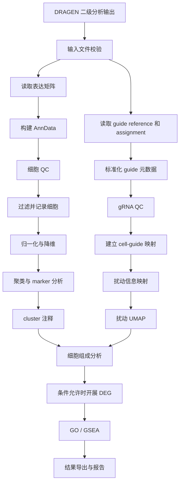

# DRAGEN scRNA CRISPR / Perturb-seq 单样本三级分析开发文档

* **文档类型**：开发设计与实施规范
* **分析范围**：单样本（single-sample）
* **输入来源**：DRAGEN scRNA 二级分析结果
* **分析框架**：Scanpy + AnnData + pertpy
* **输出目标**：标准化分析对象、QC 图表、细胞注释、扰动效应结果及可追溯报告

---

## 1. 项目目标与分析边界

### 1.1 项目目标

针对 DRAGEN scRNA CRISPR / Perturb-seq 二级分析输出，开发独立的 Python 三级分析流程，实现：

1. 读取过滤后的基因表达矩阵及 DRAGEN guide assignment 结果。
2. 完成细胞质量控制与 gRNA 分配质量控制。
3. 对基因表达数据进行标准化、降维、聚类和细胞状态注释。
4. 将 guide、target gene 和 NTC 对照映射到细胞图谱。
5. 分析不同扰动的细胞组成变化。
6. 在对照条件满足要求时，开展扰动对照 NTC 的差异表达分析。
7. 对可靠的 DEG 或基因排序结果开展 GO / GSEA 通路富集。
8. 输出机器可读结果、图表、日志及分析报告。

### 1.2 单样本分析原则

本流程仅处理一个样本，不进行跨样本整合、批次校正或多样本差异模型拟合。

| 分析内容               | 单样本可行性 | 解释边界               |
| ------------------ | ------ | ------------------ |
| 细胞 QC              | 支持     | 评估细胞和文库质量          |
| gRNA assignment QC | 支持     | 评估 guide 分配与多重感染情况 |
| UMAP / clustering  | 支持     | 探索细胞群和转录状态         |
| 扰动映射               | 支持     | 描述 guide 与细胞状态的关联  |
| 细胞组成变化             | 支持     | 描述当前样本内部的比例和计数差异   |


**重要原则：** 一个样本中的 10,000 个细胞并不等于 10,000 个独立生物学重复。单样本分析的统计结果必须与生物学推断区分。

---

## 2. 输入文件规范

### 2.1 必需输入

默认样本 ID 为 `sample1`。

| 文件                                                  | 内容                           | 用途                 |
| --------------------------------------------------- | ---------------------------- | ------------------ |
| `sample1.scRNA.filtered.matrix.mtx.gz`              | 过滤后的稀疏表达矩阵                   | 构建表达矩阵             |
| `sample1.scRNA.filtered.barcodes.tsv.gz`            | 细胞 barcode                   | 确定细胞索引             |
| `sample1.scRNA.filtered.features.tsv.gz`            | feature ID、名称及类型等            | 确定基因和 feature 类型   |
| `sample1.scRNA.feature_barcode_reference.csv`       | feature-barcode / guide 参考信息 | 解析 guide 与靶基因的对应关系 |
| `sample1.scRNA.positive_cell_guide_assignments.csv` | DRAGEN 判定为 guide 阳性的细胞分配结果   | 将扰动信息映射到细胞         |

### 2.2 输入数据契约

开发时应建立明确的数据契约，不应仅凭文件名推断 CSV 列含义。

#### 表达矩阵

使用 Matrix Market 格式读取：

* `matrix.mtx.gz`：稀疏计数矩阵。
* `barcodes.tsv.gz`：细胞 barcode 列表。
* `features.tsv.gz`：feature 元数据。

需要验证矩阵的行列维度与 barcode、feature 数量一致。

**注意：** Matrix Market 矩阵的原始方向需要结合文件维度及 DRAGEN 文件规范确认。不得在未验证的情况下直接假设行一定为细胞或基因。推荐将最终表达矩阵统一为：

* 行：细胞。
* 列：基因。
* `AnnData.X`：细胞 × 基因的原始计数矩阵。

#### Guide reference

参考表至少需要能解析以下逻辑信息：

| 逻辑字段             | 说明                    |
| ---------------- | --------------------- |
| `guide_id`       | 唯一 guide 标识           |
| `target_gene`    | guide 靶向的基因           |
| `control_type`   | NTC、targeting 或其他对照类别 |
| `guide_sequence` | 可选，guide 序列           |
| `feature_id`     | 可选，与 feature 表匹配的 ID  |

实际 CSV 列名可能与逻辑字段不同，必须通过输入检查和显式映射完成转换。

#### Positive cell guide assignments

至少需要识别：

* 细胞 barcode。
* 一个或多个阳性 guide。
* 可用时的 assignment score、置信度或其他分配状态。

如果一个 barcode 对应多行 guide 记录，必须保留多 guide 信息，不可在读取时直接去重到每个细胞只剩一个 guide。

如果 CSV 是宽表格式，也应先转换为标准化的细胞—guide 关系表。

建议在进入分析之前统一生成以下逻辑结构：

`cell_barcode | guide_id | target_gene | control_type | assignment_status | assignment_score`

其中可选字段允许缺失，但必须明确记录。

---

## 3. 技术架构

### 3.1 推荐依赖

建议使用独立 Conda 环境，并锁定经过验证的版本。

```bash
conda create -n perturbseq python=3.11 -y
conda activate perturbseq

pip install scanpy anndata pertpy pandas numpy scipy \
    matplotlib seaborn statsmodels gseapy pyyaml
```

根据所选 pertpy 分析器，安装额外依赖。例如：

```bash
pip install "pertpy[de]"
```

需要使用 pertpy 中基于 JAX 的 guide assignment 或其他相关方法时，再安装对应的可选依赖：

```bash
pip install "pertpy[jax]"
```

版本管理要求：

* 记录 Python、Scanpy、AnnData、pertpy、NumPy 和 SciPy 的实际版本。
* 将经过测试的环境固化为 `environment.yml` 或锁定文件。
* 不依赖未锁定的最新版本在不同机器上的行为一致。
* 每次升级依赖后重新执行完整测试。

pertpy 的 guide assignment、差异表达和扰动建模模块可作为实现参考：

* https://pertpy.readthedocs.io/en/stable/tutorials/notebooks/guide_rna_assignment.html
* https://pertpy.readthedocs.io/en/stable/tutorials/notebooks/differential_gene_expression.html
* https://github.com/scverse/pertpy

### 3.2 推荐目录结构

```text
perturbseq-tertiary/
├── config/
│   └── sample1.yaml
├── scripts/
│   ├── 01_validate_inputs.py
│   ├── 02_build_anndata.py
│   ├── 03_cell_qc.py
│   ├── 04_guide_qc.py
│   ├── 05_embedding_clustering.py
│   ├── 06_perturbation_mapping.py
│   ├── 07_composition.py
│   ├── 08_differential_expression.py
│   ├── 09_pathway_enrichment.py
│   └── 10_export_report.py
├── results/
│   ├── objects/
│   ├── tables/
│   ├── figures/
│   ├── enrichment/
│   ├── logs/
│   └── report/
├── environment.yml
└── README.md
```

### 3.3 分析对象设计

推荐使用 AnnData 保存基因表达数据和细胞元数据，并使用 `uns` 保存非矩阵型的分析参数和汇总信息。

| 字段                       | 内容                                     |
| ------------------------ | -------------------------------------- |
| `adata.X`                | 当前分析使用的表达矩阵                            |
| `adata.layers["counts"]` | 原始基因表达计数                               |
| `adata.obs`              | 每个细胞的 QC、guide、target、NTC、cluster 等元数据 |
| `adata.var`              | 基因 ID、名称、注释及高变基因信息                     |
| `adata.obsm["X_pca"]`    | PCA 坐标                                 |
| `adata.obsm["X_umap"]`   | UMAP 坐标                                |
| `adata.obs["leiden"]`    | 聚类标签                                   |
| `adata.uns`              | 运行参数、QC 汇总、分析版本和结果索引                   |

如果同时需要保存 guide count matrix，推荐采用 MuData，或在独立 AnnData 对象中保存 guide 数据，并使用 barcode 作为明确的连接键。

**不要把 guide 计数列直接追加到基因表达矩阵后参与常规 PCA、UMAP 或 marker 分析。**

---

## 4. 工作流总览



执行原则：

1. 先校验数据，再开始分析。
2. 先保存原始计数，再进行归一化。
3. 先完成细胞 QC 和 guide QC，再定义用于生物学分析的细胞集合。
4. 细胞聚类基于基因表达数据，不将 guide feature 当作普通基因。
5. 细胞组成分析与差异表达使用一致、可追溯的细胞和对照定义。
6. 某个可选模块不满足条件时，应记录原因并跳过，而不是强行生成结论。

---

## 5. 模块一：输入检查与 AnnData 构建

**优先级：必做**

### 5.1 输入校验

`01_validate_inputs.py` 应执行以下检查：

* 五个输入文件均存在且可读取。
* `.mtx.gz` 文件能够解析为稀疏矩阵。
* barcode 与 feature 数量匹配矩阵维度。
* barcode 是否存在重复。
* feature ID 是否存在重复或空值。
* feature 类型是否可识别。
* assignment 中的 barcode 是否能匹配表达矩阵。
* guide reference 中的 guide ID 是否能匹配 assignment。
* guide 到 target gene 的映射是否唯一，或是否存在需要显式处理的歧义。
* NTC 标记是否能从参考表或实验设计配置中可靠识别。

对未匹配的 barcode 和 guide 进行统计，并输出警告表。

不能因为少量记录无法匹配就静默丢弃数据。

### 5.2 构建表达矩阵

建议通过以下逻辑实现：

```python
from scipy.io import mmread
import gzip
import pandas as pd
import scanpy as sc

matrix = mmread(
    gzip.open("sample1.scRNA.filtered.matrix.mtx.gz", "rb")
).tocsr()

barcodes = pd.read_csv(
    "sample1.scRNA.filtered.barcodes.tsv.gz",
    sep="\t",
    header=None
)[0].astype(str)

features = pd.read_csv(
    "sample1.scRNA.filtered.features.tsv.gz",
    sep="\t",
    header=None
)

# 必须依据 DRAGEN 文件规范及矩阵维度验证矩阵方向。
# 以下示例假设 matrix 为 features × cells。
assert matrix.shape == (len(features), len(barcodes))

adata = sc.AnnData(
    X=matrix.T.tocsr()
)

adata.obs_names = barcodes.to_numpy()
adata.var_names = features.iloc[:, 0].astype(str).to_numpy()

adata.layers["counts"] = adata.X.copy()
```

这是构建逻辑的模板。正式实现还需要根据 `features.tsv.gz` 的实际列定义填充 `adata.var`，并明确 feature 类型。

如果 `features.tsv.gz` 同时包含基因表达和其他 feature type，应先依据 DRAGEN 的字段定义拆分数据。不得把 CRISPR Direct Capture 的 guide 特征误认为基因表达特征。

### 5.3 Barcode 连接规范

使用 DRAGEN 输出的原始 barcode 作为主连接键。

建议：

* 保留原始 barcode。
* 不擅自添加样本后缀或修改 barcode 格式。
* 若确实需要统一格式，必须在所有输入中执行同一转换，并记录转换规则。
* 对连接失败的记录输出 `unmatched_barcodes.tsv`。

---

## 6. 模块二：细胞 QC

**优先级：必做**

### 6.1 QC 指标

至少计算：

| 指标       | 建议字段                | 用途              |
| -------- | ------------------- | --------------- |
| 每细胞总 UMI | `total_counts`      | 识别低计数细胞及异常高计数细胞 |
| 每细胞检测基因数 | `n_genes_by_counts` | 评估转录复杂度         |
| 线粒体转录本比例 | `pct_counts_mt`     | 评估潜在低质量细胞       |
| 核糖体基因比例  | `pct_counts_ribo`   | 辅助质量评估          |
| 过滤状态     | `qc_pass`           | 保存是否通过 QC       |
| 过滤原因     | `qc_reason`         | 记录细胞被过滤的具体原因    |

线粒体和核糖体基因需要根据物种及基因命名规范识别，不能直接将人类的 `MT-` 规则用于所有物种。

### 6.2 计算 QC 指标

```python
import scanpy as sc

adata.var["mt"] = adata.var_names.str.upper().str.startswith("MT-")
adata.var["ribo"] = adata.var_names.str.upper().str.startswith(
    ("RPS", "RPL")
)

sc.pp.calculate_qc_metrics(
    adata,
    qc_vars=["mt", "ribo"],
    percent_top=None,
    log1p=False,
    inplace=True
)
```

以上基因识别规则适用于常见人类基因符号，正式实现应将其放入物种配置中。

### 6.3 过滤策略

推荐采用分布驱动的 QC 策略：

1. 绘制总 UMI、检测基因数和线粒体比例分布。
2. 结合分布、实验体系及预先定义的实验阈值确定过滤标准。
3. 对疑似双细胞或极端高计数细胞进行标记；是否过滤应根据数据特征决定。
4. 保存过滤前后的细胞数量及每项过滤规则的影响。

不要在缺少数据分布信息时固定套用一个通用阈值。

建议配置示例：

```yaml
qc:
  min_genes: null
  min_counts: null
  max_pct_mt: null
  max_genes: null
  thresholds_mode: "review_required"
```

`null` 表示由分析人员根据 QC 图确定，而不是默认不做检查。正式生产运行时，应在配置审核后填入实际阈值。

### 6.4 必需输出

```text
results/figures/qc_violin.png
results/figures/qc_scatter_counts_genes.png
results/figures/qc_scatter_mt_counts.png
results/tables/cell_qc_metrics.tsv
results/tables/cell_filter_summary.tsv
```

`cell_filter_summary.tsv` 建议包含：

| 阶段          |   细胞数 |
| ----------- | ----: |
| DRAGEN 输入细胞 | 实际统计值 |
| QC 后细胞      | 实际统计值 |
| 因低基因数过滤     | 实际统计值 |
| 因高线粒体比例过滤   | 实际统计值 |
| 其他过滤        | 实际统计值 |

需要注意：不同过滤原因可能重叠，因此原因分类计数不能直接相加后当作总过滤数。总过滤数应基于细胞唯一标识计算。

---

## 7. 模块三：gRNA QC 与 assignment 整合

**优先级：必做**

### 7.1 数据标准化

将 DRAGEN assignment 和 guide reference 转换为统一的 cell-guide 长表：

```text
cell_barcode
guide_id
target_gene
control_type
assignment_status
assignment_score
```

字段映射应通过配置完成。例如，原始文件中的 `barcode`、`guide` 或 `gene` 等列名不能未经验证就视为标准字段。

建议将原始列名映射放入 `config/sample1.yaml`，并在日志中记录解析结果。

### 7.2 每细胞 guide 数量

对每个细胞统计：

* 分配的 guide 数量。
* 是否未分配 guide。
* 是否仅有一个 guide。
* 是否有多个 guide。
* 是否存在未知 guide。
* 是否同时携带 NTC 和 targeting guide。

推荐字段：

```text
n_guides
guide_assignment_class
has_ntc
has_targeting_guide
is_multiplet_guide
```

`guide_assignment_class` 可采用以下类别：

* `no_guide`
* `single_guide`
* `multiple_guides`
* `ambiguous`

具体类别定义需要与 DRAGEN assignment 规则保持一致。

### 7.3 Guide 统计

至少输出：

1. 每个 guide 对应的细胞数柱状图。
2. 每细胞 guide 数量分布图。
3. guide 与 target gene 对照表。
4. guide assignment 汇总表。
5. 未匹配 barcode 和 guide 的诊断表。

建议结果文件：

```text
results/figures/guide_cell_counts.png
results/figures/guides_per_cell.png
results/tables/guide_assignment_summary.tsv
results/tables/guide_target_mapping.tsv
results/tables/guide_unmatched_records.tsv
```

### 7.4 DRAGEN 与 pertpy 的职责划分

本流程以 DRAGEN 的 `positive_cell_guide_assignments.csv` 为默认 guide assignment 来源。

pertpy 的 `GuideAssignment` 提供基于阈值或混合模型的 guide 分配方法，可作为可选的交叉验证或重新分配工具。

但需要注意：

* 不能直接对已经分配好的结果再次进行 assignment，并覆盖 DRAGEN 结果。
* 如果要重新分配，必须有与之匹配的原始 guide count matrix。
* 只有 positive assignment 表时，通常不能完整复现所有 guide 的阴性分布。
* 如果 DRAGEN 与 pertpy 的分配结果不一致，应将差异作为 QC 结果输出，而不是自动选择其中一个。

参考：

https://pertpy.readthedocs.io/en/stable/tutorials/notebooks/guide_rna_assignment.html

---

## 8. 模块四：标准化、降维与聚类

**优先级：必做**

### 8.1 分析对象选择

聚类使用通过 QC 的基因表达矩阵。

不应将以下数据混入常规基因表达聚类：

* gRNA feature counts。
* guide assignment 状态。
* target gene 标签。
* NTC / targeting 标签。

这些信息只用于后续着色、分组和扰动分析。

### 8.2 推荐流程

1. 保存 QC 后原始计数。
2. 计算高变基因。
3. 进行 library-size normalization。
4. 执行 log1p 转换。
5. 根据数据质量选择是否回归协变量。
6. Scale、PCA、邻接图计算。
7. UMAP。
8. Leiden clustering。
9. 输出各 cluster 的 marker genes。

### 8.3 代码模板

```python
import scanpy as sc

# 建议先保留 QC 后的原始计数
adata_qc = adata[adata.obs["qc_pass"]].copy()
adata_qc.layers["counts"] = adata_qc.X.copy()

# 高变基因与标准化
sc.pp.highly_variable_genes(
    adata_qc,
    flavor="seurat",
    n_top_genes=2000
)

adata_qc.raw = adata_qc.copy()

sc.pp.normalize_total(
    adata_qc,
    target_sum=1e4
)

sc.pp.log1p(adata_qc)

# 使用高变基因进行降维
adata_hvg = adata_qc[
    :, adata_qc.var["highly_variable"]
].copy()

sc.pp.scale(
    adata_hvg,
    max_value=10
)

sc.tl.pca(
    adata_hvg,
    svd_solver="arpack"
)

sc.pp.neighbors(
    adata_hvg,
    n_neighbors=15,
    n_pcs=30
)

sc.tl.umap(adata_hvg)

sc.tl.leiden(
    adata_hvg,
    resolution=0.5,
    key_added="leiden"
)
```

上述参数是初始示例，不是适用于所有样本的固定值。实际使用的 `n_top_genes`、`n_pcs`、`n_neighbors` 和 `resolution` 应结合细胞数量、表达复杂度及聚类稳定性进行评估。

正式实现时，应确保聚类结果、UMAP 坐标和细胞元数据能可靠地回写到完整 QC 后的 AnnData 对象中。不要直接假设使用 HVG 子集后得到的对象仍包含所有基因。

### 8.4 Marker 分析

```python
sc.tl.rank_genes_groups(
    adata_hvg,
    groupby="leiden",
    method="wilcoxon"
)

markers = sc.get.rank_genes_groups_df(
    adata_hvg,
    group=None
)

markers.to_csv(
    "results/tables/cluster_markers.tsv",
    sep="\t",
    index=False
)
```

输出 marker 表至少包含：

* cluster。
* gene。
* log fold change。
* P 值。
* 校正后 P 值。
* 表达比例或相关表达统计量（如适用）。

这些 marker 主要用于探索性聚类注释。细胞层级的检验同样受到伪重复和细胞间相关性的影响，不应将 marker 的显著性直接解释为独立生物学重复支持的结论。

### 8.5 细胞状态注释

细胞注释分为两级：

1. **cluster 级注释**：根据 marker genes、经典细胞类型标志基因和研究背景进行初步命名。
2. **扰动相关状态注释**：在 cluster 基础上，根据扰动组的表达特征进一步识别状态变化。

建议输出：

```text
results/figures/umap_clusters.png
results/figures/umap_marker_features.png
results/tables/cluster_markers.tsv
results/tables/cluster_annotation.tsv
```

`cluster_annotation.tsv` 建议包含：

```text
cluster
cell_count
top_markers
proposed_cell_type
annotation_confidence
annotation_evidence
```

如果缺少可靠的 marker 或参考注释，应保留 `unknown` 或 `unresolved`，而不是强制赋予细胞类型。

---

## 9. 模块五：扰动信息映射

**优先级：必做**

### 9.1 元数据设计

将 guide assignment 整合到 `adata.obs`。

建议字段：

| 字段                        | 说明                      |
| ------------------------- | ----------------------- |
| `guide_id`                | 单 guide 细胞对应的 guide ID  |
| `target_gene`             | 目标基因                    |
| `control_type`            | NTC 或 targeting 等类别     |
| `n_guides`                | 该细胞的 guide 数量           |
| `perturbation_class`      | 单 guide、多个 guide、未分配等状态 |
| `guide_assignment_status` | 原始 assignment 状态        |
| `leiden`                  | cluster ID              |
| `cell_state`              | 注释后的细胞状态                |

由于一个细胞可能携带多个 guide，不能把所有细胞强制归类为单一 target gene。

推荐保留两个层次：

* **单 guide 分析集合**：仅保留符合预设规则的单 guide 细胞。
* **完整映射集合**：保留多 guide、未分配和歧义细胞，用于完整 QC 和图谱展示。

### 9.2 UMAP 着色

至少生成以下 UMAP：

* 按 guide ID 着色。
* 按 target gene 着色。
* 按 NTC / targeting 类别着色。
* 按 cluster 着色。
* 可选：按 guide assignment 状态着色。

示例：

```python
sc.pl.umap(
    adata_hvg,
    color=["leiden"],
    save="_clusters.png",
    show=False
)
```

扰动元数据需要先映射到用于绘图的对象，再分别生成 guide、target gene 和 NTC 图。

### 9.3 对照定义

NTC 不能只依赖字符串中是否包含 `NTC` 来判断。

推荐优先级：

1. 实验设计或 guide reference 中的明确 control 标记。
2. 经确认的 guide ID 与 target gene 映射。
3. 对缺失或冲突记录标记为 `unknown`，并要求人工审核。

建议配置：

```yaml
controls:
  ntc_guide_ids: []
  control_annotation_column: null
  control_annotation_value: "NTC"
```

实际运行前必须填写或确认对照定义。

---

## 10. 模块六：细胞组成变化

**优先级：推荐**

### 10.1 分析目标

统计每个 guide 或 target gene 在不同 cluster / cell state 中的：

* 细胞数。
* 该扰动内的 cluster 占比。
* 该 cluster 内的扰动占比。
* 与 NTC 的描述性差异。

需要明确分母：

$$
p_{g,c}=\frac{n_{g,c}}{\sum_c n_{g,c}}
$$

其中：

* \(n_{g,c}\)：扰动 \(g\) 在 cluster \(c\) 中的细胞数。
* \(p_{g,c}\)：扰动 \(g\) 的细胞中属于 cluster \(c\) 的比例。

这与 cluster 内某个扰动的比例不同，报告中应分别标记。

### 10.2 推荐输出

```text
results/figures/cluster_composition_stacked_bar.png
results/figures/cluster_composition_heatmap.png
results/tables/perturbation_cluster_counts.tsv
results/tables/perturbation_cluster_proportions.tsv
```

### 10.3 单样本解释边界

可以报告观察到的细胞比例和计数，但不能仅凭一个样本中的细胞比例差异推断总体人群中的显著组成变化。

特别是：

* 细胞捕获率可能影响观察到的比例。
* 不同 guide 的转导或捕获效率可能不同。
* 同一细胞群中的细胞并非独立生物学重复。
* NTC 细胞数过少时，比较结果不稳定。

因此，建议将本模块定位为描述性分析，必要时只输出效应大小、计数及不确定性说明，不默认生成确认性显著性结论。

---

## 11. 模块七：差异表达分析

**优先级：有合适对照时**

### 11.1 分析问题

对每个扰动组与 NTC 进行表达比较。

推荐比较单位：

```text
target_gene / guide_id  vs  NTC
```

可以在全体合格细胞中比较，也可以在特定 cluster 或 cell state 内比较。

优先建议：

1. 先明确扰动分组。
2. 评估每组细胞数量、guide 数量及 NTC 数量。
3. 确认比较组在细胞类型或状态上的可比性。
4. 明确差异表达分析是探索性筛查还是正式推断。
5. 输出每个比较的细胞数和结果适用性说明。

### 11.2 pertpy 使用原则

pertpy 提供多种差异表达接口，包括简单统计检验和 pseudobulk / count-based 模型。

参考：

https://pertpy.readthedocs.io/en/stable/tutorials/notebooks/differential_gene_expression.html

在有多个独立生物学重复时，推荐考虑 pseudobulk 结合 edgeR 或 PyDESeq2 等模型。

但是，本项目仅有一个样本：

* 同一个样本中按细胞聚合不能创造独立生物学重复。
* 将细胞当作独立重复拟合普通差异表达模型，可能产生过于乐观的 P 值。
* 对 NTC 与 perturbation 的比较，无法通过单个样本估计跨样本变异。

因此，**单样本 DEG 应默认作为探索性结果**。可以输出 log fold change、检验统计量、名义 P 值和多重检验校正结果，但必须标明统计限制。

如果实验目标要求可靠的生物学推断，应增加独立生物学重复，并使用与实验设计相匹配的模型。

### 11.3 DEG 过滤与结果格式

每个比较应独立生成结果文件。

```text
results/tables/deg/
├── guide_A_vs_NTC.tsv
├── guide_B_vs_NTC.tsv
└── target_GENE1_vs_NTC.tsv
```

建议结果字段：

```text
comparison
guide_id
target_gene
cluster
gene
logfoldchange
pvalue
padj
n_cells_perturbation
n_cells_ntc
analysis_method
interpretation_status
```

具体字段名称以所用分析器的实际输出为准，导出前统一映射。

### 11.4 DEG 图表

每个满足最低分析条件的比较生成：

* 火山图。
* Top DEG 热图。
* DEG 数量汇总。
* 各组细胞数和检测基因数统计。

推荐路径：

```text
results/figures/deg/volcano_guide_A_vs_NTC.png
results/figures/deg/heatmap_guide_A_vs_NTC.png
results/tables/deg_summary.tsv
```

若 NTC 缺失、对照数量不足或分组定义有歧义，应记录跳过原因，而不是生成看似完整的结果。

---

## 12. 模块八：GO / GSEA 通路分析

**优先级：有可靠 DEG 或排序结果时**

### 12.1 运行条件

至少满足以下条件：

* 有可靠的基因 ID 到标准基因符号的映射。
* DEG 或排序结果包含足够多的有效基因。
* 预先定义合理的背景基因集。
* 基因排序指标与所用 GSEA 方法匹配。
* 已知当前结果来自单样本探索性比较。

如果 DEG 数量过少、基因 ID 无法识别或排序结果不稳定，应跳过通路分析。

### 12.2 推荐方法

**过度富集分析（ORA）**

适用于有合理阈值筛选出的 DEG 集合。背景集应优先使用本次分析中有资格被检验的基因，而不是无条件使用全基因组。

**GSEA**

使用全基因排序结果，避免仅依赖硬阈值筛选 DEG。

可根据研究需要使用：

* GO Biological Process。
* GO Molecular Function。
* GO Cellular Component。
* 其他经过版本记录的基因集。

### 12.3 输出

```text
results/enrichment/
├── guide_A_vs_NTC/
│   ├── go_ora.tsv
│   ├── gsea.tsv
│   ├── go_dotplot.png
│   └── gsea_enrichment_plot.png
└── pathway_summary.tsv
```

结果应记录：

* 基因集来源及版本。
* 背景基因数。
* 输入基因数。
* 命中基因数。
* 富集统计量。
* 多重检验校正结果。

单样本 DEG 的统计不确定性会传递到富集分析，因此通路结果应作为假设生成，而不是独立验证。

---

## 13. 结果输出与报告规范

### 13.1 必须交付的文件

| 分析模块              | 推荐输出                                     | 优先级            |
| ----------------- | ---------------------------------------- | -------------- |
| 细胞 QC             | QC violin、scatter、过滤前后细胞数统计              | 必做             |
| gRNA QC           | guide 细胞数柱状图、每细胞 guide 数分布、assignment 汇总 | 必做             |
| UMAP / clustering | cluster UMAP、marker 表、细胞状态注释             | 必做             |
| Perturbation 映射   | 按 guide、target gene、NTC 着色的 UMAP         | 必做             |
| 细胞组成变化            | 各扰动在 cluster 中的比例及计数                     | 推荐             |
| 差异表达              | 每个扰动对照 NTC 的 DEG 表、火山图、热图                | 有合适对照时         |
| 通路分析              | GO / GSEA 富集结果、富集图                       | 有可靠 DEG 或排序结果时 |

### 13.2 AnnData 输出

建议保存：

```text
results/objects/sample1_perturbseq_qc.h5ad
results/objects/sample1_perturbseq_final.h5ad
```

前者保留 QC 和原始计数等信息，后者包含完成的降维、聚类和扰动元数据。

如果需要同时保存 guide count matrix，推荐单独保存或使用 MuData，避免在基因表达矩阵中混入不兼容的 feature。

### 13.3 汇总报告

建议生成：

```text
results/report/sample1_analysis_report.md
```

报告至少包含：

1. 输入文件及校验结果。
2. 软件版本及配置。
3. QC 过滤规则和前后细胞数量。
4. guide assignment 汇总。
5. 聚类及 marker 结果摘要。
6. target gene / guide / NTC 的映射结果。
7. 细胞组成描述性结果。
8. DEG 和通路分析的运行条件与跳过原因。
9. 单样本统计限制。
10. 输出文件清单及日志位置。

---

## 14. 配置文件规范

建议通过 YAML 配置控制输入路径、字段映射、QC 阈值、NTC 定义及分析参数。

```yaml
sample:
  id: "sample1"
  species: "human"

input:
  matrix: "input/sample1.scRNA.filtered.matrix.mtx.gz"
  barcodes: "input/sample1.scRNA.filtered.barcodes.tsv.gz"
  features: "input/sample1.scRNA.filtered.features.tsv.gz"
  guide_reference: "input/sample1.scRNA.feature_barcode_reference.csv"
  guide_assignments: "input/sample1.scRNA.positive_cell_guide_assignments.csv"

guide_mapping:
  # 必须按实际 CSV 列名填写
  barcode_column: null
  guide_id_column: null
  target_gene_column: null
  control_type_column: null
  assignment_score_column: null

controls:
  ntc_guide_ids: []
  control_annotation_value: "NTC"

qc:
  min_genes: null
  min_counts: null
  max_pct_mt: null
  max_genes: null

embedding:
  n_top_genes: 2000
  n_pcs: 30
  n_neighbors: 15
  leiden_resolution: 0.5
  random_seed: 0

differential_expression:
  enabled: true
  interpretation: "exploratory_single_sample"
  min_cells_per_group: null

pathway:
  enabled: true
  gene_set_database: "GO_Biological_Process"
  fdr_threshold: 0.05

output:
  root: "results"
```

说明：

* `null` 字段必须在运行前通过输入检查、人工审核或受控的自动识别补全。
* `min_cells_per_group` 应根据分析目的和数据质量确定，不应被视为普适统计保证。
* `random_seed` 用于可重复性控制，但不能保证所有底层库、硬件和版本均产生完全相同的结果。
* `fdr_threshold` 是结果筛选参数，不代表单样本的统计推断限制已经解决。

---

## 15. 运行入口与异常处理

建议提供统一命令行入口：

```bash
python -m scripts.01_validate_inputs \
  --config config/sample1.yaml

python -m scripts.02_build_anndata \
  --config config/sample1.yaml

python -m scripts.03_cell_qc \
  --config config/sample1.yaml

python -m scripts.04_guide_qc \
  --config config/sample1.yaml

python -m scripts.05_embedding_clustering \
  --config config/sample1.yaml

python -m scripts.06_perturbation_mapping \
  --config config/sample1.yaml

python -m scripts.07_composition \
  --config config/sample1.yaml

python -m scripts.08_differential_expression \
  --config config/sample1.yaml

python -m scripts.09_pathway_enrichment \
  --config config/sample1.yaml

python -m scripts.10_export_report \
  --config config/sample1.yaml
```

以上命令是接口设计示例；开发时应根据实际 Python 包结构确定模块名称，并为每个阶段实现 CLI。

### 15.1 异常处理要求

| 异常情况                 | 处理方式                 |
| -------------------- | -------------------- |
| 输入文件缺失               | 终止任务并输出缺失清单          |
| 矩阵维度不匹配              | 终止任务                 |
| Barcode 重复           | 输出诊断并要求明确处理策略        |
| Guide reference 无法匹配 | 输出未匹配记录；必要时终止扰动分析    |
| NTC 不存在              | 跳过 NTC 对照 DEG，继续其他模块 |
| 某个 guide 细胞数过少       | 标记低支持度，跳过或仅描述        |
| 细胞数不足以稳定聚类           | 输出警告，避免强行解释 cluster  |
| DEG 无有效排序结果          | 跳过 GSEA              |
| 某模块失败                | 保存日志及失败状态，不伪造结果      |

推荐在日志中记录每个模块的开始时间、结束状态、参数、输入对象、输出文件和异常信息。

---

## 16. 开发验收标准

### 16.1 输入与数据完整性

* [ ] 五个必需文件全部经过检查。
* [ ] 矩阵方向和维度验证通过。
* [ ] Barcode 和 feature ID 保持一致。
* [ ] Guide reference 和 assignment 完成标准化。
* [ ] 所有未匹配记录均可追踪。
* [ ] 原始计数被保留。

### 16.2 必做分析

* [ ] QC violin、scatter 图生成成功。
* [ ] 过滤前后细胞数统计生成成功。
* [ ] Guide 细胞数柱状图生成成功。
* [ ] 每细胞 guide 数分布图生成成功。
* [ ] Guide assignment 汇总表生成成功。
* [ ] UMAP、cluster 和 marker 表生成成功。
* [ ] 细胞状态注释表生成成功。
* [ ] Guide、target gene 和 NTC 的 UMAP 着色结果生成成功。

### 16.3 条件分析

* [ ] 细胞组成计数和比例输出成功，或记录跳过原因。
* [ ] 存在合适 NTC 时才开展 DEG。
* [ ] DEG 输出统计方法、组别细胞数和探索性解释标签。
* [ ] 存在可靠的 DEG 或排序结果时才开展通路分析。

### 16.4 可重复性

* [ ] 软件环境和配置已归档。
* [ ] 关键参数有默认值或明确的审核要求。
* [ ] 随机种子已记录。
* [ ] 所有图表、表格和分析对象均有固定输出路径。
* [ ] 分析报告能够追踪每个结果的来源。

---

## 17. 参考文档

1. **DRAGEN scRNA CRISPR mode**

   https://help.dragen.illumina.com/dragen-v4.5/product-guides/dragen-v4.5/dragen-single-cell-pipeline/dragen-scrna-illumina#crispr-mode

2. **Single-cell best practices: Perturbation modeling**

   https://www.sc-best-practices.org/conditions/perturbation-modeling/

3. **Illumina Connected Multiomics: Perturb-seq walkthrough**

   https://help.multiomics.illumina.com/icm/analyses/walkthroughs/perturb-seq

4. **pertpy: Guide RNA assignment**

   https://pertpy.readthedocs.io/en/stable/tutorials/notebooks/guide_rna_assignment.html

5. **pertpy: Differential gene expression**

   https://pertpy.readthedocs.io/en/stable/tutorials/notebooks/differential_gene_expression.html

6. **sc-best-practices: Differential gene expression**

   https://www.sc-best-practices.org/conditions/differential-gene-expression/

7. **pertpy source repository**

   https://github.com/scverse/pertpy

---

## 18. 实施结论

本项目应优先完成一个可追溯、可复现的单样本三级分析 MVP：

1. 正确解析 DRAGEN 输出并构建 AnnData。
2. 完成细胞 QC 和 guide assignment QC。
3. 完成表达降维、聚类、marker 和细胞状态注释。
4. 将 guide、target gene 和 NTC 映射至细胞图谱。
5. 输出细胞组成描述性结果。
6. 根据 NTC、细胞数量和数据质量决定是否执行探索性 DEG。
7. 根据 DEG 或排序结果质量决定是否执行 GO / GSEA。
8. 统一导出分析对象、表格、图表和 Markdown 报告。

**关键开发原则：先保证输入映射和数据语义正确，再追求下游模型复杂度。** 尤其需要避免 guide 与基因表达特征混用、误识别 NTC、忽略多 guide 细胞，以及将单样本的细胞级统计误解为生物学重复验证。

本规范中的代码片段用于说明关键实现方式。正式部署前，还需要根据实际 `features.tsv.gz`、`feature_barcode_reference.csv` 和 `positive_cell_guide_assignments.csv` 的列结构完成字段映射，并通过真实样本验证整个流程。
